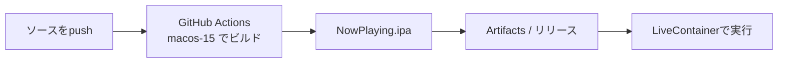

ショートカットで作っていた「#NowPlaying」投稿ツールを、iOSアプリにした。




## 経緯

元はiOSショートカット版で、SpotifyのWeb APIから再生中の曲を取り、文面を作ってXの投稿画面に渡すものだった。v10まで作り込んで実用レベルに達していたが、ショートカットでは「ウィジェットに今の曲を出す」みたいなことができない。話が広がって、ちゃんとしたアプリにすることにした。

手元のMacにはXcodeが入っていないので、ビルドはGitHub Actionsに任せ、署名なしの.ipaを作ってSideStore / LiveContainerでiPhoneに入れる方式にした。開発はAI（Muse）に壁打ちしながら、都度こちらで実機確認して進めた。v1.0の初回ビルドから現行のv1.8.1まで、作業はほぼ2026年11月20日の1日に集中している。



## 既にあるのに、なぜ作ったのか

再生中の曲を投稿するアプリ自体は既にある。2011年から続く老舗もあれば、2026年3月リリースの新しいものもある。

Androidには、メイン機だった頃に長らくお世話になっていたNowPlaying4Droidという理想形もある。既定の文面が「#NowPlaying 曲名 - アーティスト (アルバム名)」で、自分の形式とほぼ同じだ。iOS側は事情が違って、Spotifyの再生を直接読めるものがない。大半は端末内で再生中の曲を読む方式で、Spotifyは対象外になる。なうぷれはSpotify対応を謳うけど、共有シート経由の取り込みで、再生そのものを読んでいるわけじゃない。iOSの3つはどれも広告が入っていて、課金の形も広告除去のサブスクや投稿チケット制などバラバラ。曲のURLは、なうぷれ以外は付けられない（老舗の方に付くのはYouTubeの検索URL）。文面も、実際の出力が「#Nowplaying Love To Sing 2016 - myice92 (EP II)」という具合に綴りが違ったり、区切りが「 / 」だったり、アルバム名が原題のまま入ったりと、自分の形式とは違う。どれも自分の使い方には合わなかった。

参考に、既存のアプリ3つで同じ曲（Luna say maybe）を開いた画面を並べておく。






- 出発点がショートカットだった。既製品を探して乗り換える前に、自分の道具の方が先に育っていた。アプリはその延長で、文面マクロの仕様はショートカット版から引き継いでいる
- 文面の形式。#NowPlaying の後に曲名、アーティストはクレジット全員、最後にアルバム名でURLはなし、という自分の形式をそのまま使いたかった
- ジャケ写のマッチング。「検索の1件目」で済ませる方式ではカラオケ版が混ざる問題が残る。ここは自分で方式を決めたかった
- 投稿先（Xアプリ／X API／Bluesky／Mastodon／Misskey）とLast.fmのスクロブルまで、自分の使い方に寄せたかった

作る手段があったのも大きい。AIに壁打ちしながら作る形で、仕様を自分で決められるところまで来ていた。

## ビルドの流れ



- ソースはSwift + SwiftUI。プロジェクトファイルはXcodeGenの project.yml から生成する
- v* のタグを打つと、リリースにも.ipaが添付される
- 署名なしなのでApp Storeには出せないし、SideStoreで通常インストールする場合は7日ごとの更新が要る

## バージョン履歴

| バージョン | 主な内容 |
| :-- | :-- |
| v1.0 | 初回ビルド成功。LiveContainerに入れて、Spotify / Apple Music 両方の取得を確認 |
| v1.1 | autoの優先順位を修正 |
| v1.2 | 配布用の整備。設定の一般化、日英ローカライズ、READMEとライセンス |
| v1.3 | MediaRemoteを直接叩くプローブを追加（後述の理由で不採用が確定） |
| v1.4 | 直接投稿を追加。X API（OAuth 1.0a、画像付き）、Bluesky、Mastodon、Misskey |
| v1.5 | 文面の編集欄、Xの重み付け文字数カウント、取得履歴（20件）、フォーマットプリセット、App Shortcuts、コントロールセンター用ウィジェット（iOS 18+） |
| v1.5.1 | LiveContainerでバージョンが「1.0」表示で、アイコン真っ白だった問題に対処 |
| v1.6.0 | UIをカード基調に刷新。Last.fm連携（取得元として追加＋スクロブル） |
| v1.6.1〜1.6.5 | 取得／投稿ボタンの下部固定、履歴の重複排除、設定画面の整理、ジャケ写の間違い報告 |
| v1.7.0 | ジャケ写のマッチングを段階制に。MusicBrainz追加、候補ピッカー |
| v1.7.1 | ジャケ写の検索増量＋カラオケ除外（逆効果、後述） |
| v1.7.2 | ジャケ写をアルバム検索＋lookup方式に変更（後述） |
| v1.8.0 | YouTube Musicをデータソースに追加。ジャケ写ソースの優先順位を設定で並び替え可能に |
| v1.8.1 | SNS等のアイコンを公式ブランドロゴ（Simple Icons）に差し替え |

## 工夫したところ

### 「この端末」を優先するauto判定

取得元はSpotify / Apple Music / Last.fm から選べる。Last.fmはautoの対象外で、選んだときだけ使う。autoのときは「この端末で再生中のもの」を優先する。他の端末で一時停止しているSpotifyを拾ってしまうことがあったので、/me/player のデバイス名と端末名を突き合わせて判定している。

| 優先 | 条件 | 取得元 |
| :-- | :-- | :-- |
| 1 | Spotifyがこの端末で再生中 | Spotify |
| 2 | Apple Musicが再生中 | Apple Music |
| 3 | Spotifyがこの端末で一時停止 | Spotify |
| 4 | Apple Musicが一時停止中 | Apple Music |
| 5 | 他の端末で再生・停止中 | Spotify |

### ジャケ写のマッチング

ここが一番苦労した。最初はiTunes検索の先頭の結果をそのまま使っていて、カラオケ版のジャケ写を掴むことが多かった。「檄! 帝国華撃団 - 改」でカラオケ版になったのがきっかけで、アプリの報告機能を試すついでに、自分で [Issue #1](https://github.com/aoiro-labo/nowplaying-ios/issues/1) を立てた。

厄介だったのは、検索の並びが環境で変わること。手元の回線ではカラオケ盤が大量に上位に来る一方、検証環境では再現しないので、「直った」ように見えてしまう。

| バージョン | 方式 | 結果 |
| :-- | :-- | :-- |
| 初期〜v1.6 | iTunes検索の先頭を採用 | カラオケ版を掴むことがある |
| v1.7.0 | 曲名・アルバム・アーティストの段階制マッチング＋候補ピッカー | まだカラオケ盤が残る |
| v1.7.1 | 検索を2クエリ×25件に増量＋カラオケ除外 | 逆にカラオケが増えた |
| v1.7.2 | アルバム検索でコレクションを特定し、lookupで収録曲から選択 | 実機で正しいジャケ写になった |

順位に頼るのをやめて、アルバム名の一致で盤を特定してから曲を引く、という順番にしたのが効いた。比較のときは、アルバム名の末尾の「 - EP」「 - Single」「 - Album」を落とし、全角記号を半角に寄せてスペースを抜いて比べている。ほかにMusicBrainzとYouTube Music、再生元（Spotify等）のジャケ写も候補にできて、優先順位は設定で並び替えできて、既定はiTunes → MusicBrainz → YouTube Music → 再生元の順。候補ピッカーから手で選ぶこともできるし、「正解として報告」でIssueに送る導線も付けた。

同じ「檄! 帝国華撃団 - 改」で、カラオケ版を掴んだ状態（左）、Spotifyで表示される本来のジャケ写（中）、修正後のアプリ（右）。






ジャケ写の長押しメニューと、候補ピッカーはこんな感じ。






### 文面の組み立て

文面は `{track}` `{artist}` `{album}` `{url}` のマクロで組み立てる。自分の既定はURLなしで、こうなる。

```text {filename="文面の例"}
#NowPlaying 真っ白いページと水彩の主人公 - 初星学園, 佐藤貴文, 花海佑芽 (真っ白いページと水彩の主人公)
```

プリセットと編集欄は一本化してあって、編集すると選択中のプリセット自体が書き換わる。文字数はXの重み付けで数えていて、280字に収まるかはその場で分かる。

設定画面の文面セクションはこんな感じ。


実際の画面はこんな感じで、投稿文と履歴が並ぶ。


履歴は長押しで投稿文のコピーや削除ができる。


実際に投稿した例がこれ。「ワールドイズマイン」はショートカット時代にジャケ写とURLが壊れた曲で、アプリでは正しい盤のものが出るようになった。



### 投稿まわり

基本は共有シート。直接投稿も付けていて、X API（OAuth 1.0a、ジャケ写付き）、Bluesky（アプリパスワード）、MastodonとMisskey（インスタンスとトークンを設定）はアプリからそのまま送れる。Xはアプリを開いて投稿画面に渡すこともできる。

> [!IMPORTANT]
> 認証情報について。Spotifyのrefresh tokenや、X API・Bluesky・Mastodon・Misskeyのトークン類は、この端末のアプリ内の設定にだけ保存される。ソースコードやリポジトリに含める作りにはしていない。この記事の設定画面などのスクリーンショットでも、キー類はマスクしてある。

設定画面はこんな感じで、取得元やURLの付け方を選ぶ。


### そのほか

- Spotifyのrefresh tokenはローテーションで新しいものが返ってくることがあるので、返ってきたら保存し直す
- Last.fmは取得時に updateNowPlaying を送り、投稿のタイミングでスクロブルする
- 履歴は同じ曲＋同じ文面なら全体から重複を除いて先頭に移す。ジャケ写のサムネイルが無い場合は前のものを引き継ぐ
- ジャケ写は、iTunesの100pxのURLを1200pxに差し替えて高画質で取る設定がある
- 設定とトークンはApp Group経由でウィジェットとも共有している

Last.fmまわりは、APIアカウントを作るところから。






## Apple MusicとiOSの制約

Spotifyは公式のWeb APIがあるので、再生情報をサーバー側から引っ張って解決できた。Apple側はそうはいかない。開発中にぶつかった制約を並べると、だいたいAppleの仕様の話になる。




### 端末内の再生曲はApple Musicしか取れない

iOSでは、他のアプリが今何を再生しているかを知る公開APIがない。MediaPlayerで取れるのはミュージックアプリ（Apple Music）の再生曲だけで、Spotifyアプリの再生状態は端末内からは見えない。だからSpotifyはWeb API経由、という設計になっている。既存アプリでも事情は同じで、なうぷれはSpotifyやYouTube Musicの曲を共有シート経由で取り込む方式になっている。YouTube Musicに至っては再生状態を見る公式API自体がないので、v1.8.0で足したのもジャケ写などのメタデータ取得だけだった。

### 「iTunesメディア」というプレースホルダ

Apple Musicの「現在の曲」は、状況によって「iTunesメディア」という名前で詳細が空のプレースホルダを返すことがある。アーティスト名が空なら採用しない、という健全性ゲートを入れた。同じような状態でも正常／プレースホルダ／エラーの3通りを返すので、ショートカット版の頃から引きずっている問題でもある。

ショートカット版で実際に化けたときの投稿画面がこれ。曲名が「iTunesメディア」になり、アーティストとアルバムが空になっている。


### MediaRemoteの壁

MediaRemote.frameworkを直接叩いて再生情報を取るプローブを作って試した。

> [!NOTE]
> entitlement（com.apple.mediaremote.now-playing-read-access）の無いアプリには、再生中でも info が nil で返ってくる。サイドロードでは付けられないし、TrollStoreもiOS 17.0までで手元のiOS 27では使えない。この方法は使えないと確定した。


### 金の話

まともに配布しようとするとApple Developer Program（年99ドル）が要る。やめればアプリも消える。無料の範囲だと署名の有効期限が7日で、SideStoreで更新し続けるしかない。個人で使うだけの道具に年額を払う気はないので、野良.ipaのままにしている。

## ハマったところ・ミス

- 開発側のミスで、Trackの初期化を思い込みで書いてビルドを落としたことがある。既存の型は実物を見てから書く、という当たり前の話だった
- LiveContainerではバージョンが「1.0」と表示されたままで、アイコンが真っ白という問題があった。project.yml にバージョンを明示して、アプリアイコンのアセットを入れて対処した（v1.5.1）
- タグを打ってリリースを作っても .ipa が付いてこなかったことがある。ワークフローにリリースへの書き込み権限（contents: write）が無かったのが原因で、付けてからは付くようになった

## 今の状態

現行はv1.8.1で、.ipaもリリースに付いている。リポジトリは公開していて、ライセンスはMIT。





<script async src="https://platform.twitter.com/widgets.js" charset="utf-8"></script>
