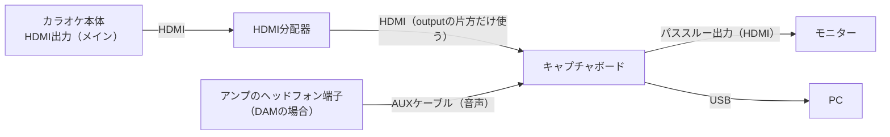

カラオケの画面を、歌詞テロップごとそのまま録画したい。結論から書くと、デジタル出力であれば基本問題ない、アナログ出力は変換噛ませればいける。

## 収録環境

撮影・収録場所

- DAM：某所の快活CLUB、ビッグエコー
- JOYSOUND：某所のJOYJOY

使った機種はこのあたり。

- DAM：LIVE DAM Ai（DAM-XG8000）、ステレオデジタルハイパワーアンプ（DAM-AD8000）
- JOYSOUND：JOYSOUND MAX GO




## 準備するもの

必要なものはDAMとJOYSOUNDでほぼ共通。違うのは音声の取り込み方だけ。

| 必要なもの | 用途 |
|---|---|
| キャプチャボード | 映像の録画。1080p以上に対応していれば良い |
| HDMI分配器 | 映像をモニターとキャプボに分ける。HDCPを無視できる個体がある |
| HDMIケーブル | 今回の構成では3本ぐらい |
| AUXオーディオ接続コード（3.5mm） | DAM用。アンプからキャプボへ音声を入れる |
| RCA→3.5mm変換ケーブル、またはUSBオーディオキャプチャ | JOYSOUND用（MAXまでの機種） |

なお、ここに挙げたものは必ずしも全部揃えなきゃいけないわけではない。揃えたほうがやりやすい、というだけ。

### キャプチャボード

当方で検証済みなのは、AVerMediaのLive Gamer Portable 2（AVT-C878）とLive Gamer EXTREME 3（GC551G2）の2つ。一番直近の収録はGC551G2でやっている。

選ぶ基準として、音声入力とパススルー出力に対応しているキャプチャボードが好ましい。音声入力がないと音声をキャプボに取り込めず、パススルー出力がないと映像をモニターに戻せない。

AVT-C878は、電源もPCとの接続もMicroUSB Type-B（2.0）1本でまかなうタイプ。録画方法はPC経由とキャプボ単体の2通りがあって、PC経由ではUSBケーブルでPCと繋ぎ、OBS Studio等のソフトで取り込む。単体で録画する場合はPCから給電できないので、別途USB電源アダプターが要る。GC551G2は単体録画の機能自体がないので、録画はPC経由のみになる。

なお、同じAVerMediaでもGC551G2などは、Assist Central ProでHDCP検出をオフにした状態でゴニョゴニョしないとHDCP Protectionに阻まれるので注意。

DAM側の出力は最大1080p60だが、JOYSOUNDの一部機種は4K画質に対応しているので（意味があるかは別として）これより上位のものを購入しても良いとは思う。ただし、下記のHDMI分配器は1080pまでしか対応していないので、キャプボを4K録画対応のものにする場合は分配器も4K出力に対応したものにすることをおすすめする。

なお、一部の中華製格安キャプボはHDCPを兼ね備えているが、パススルー出力できたほうが何かと便利なので、HDMIスプリッター＋普通のキャプボがおすすめ。

中華製の格安キャプボなら、よっぽどのことがなければWindowsでも使えるはず。ただ、所詮は中華キャプボなので、音とか映像とかで何かしら問題が起きる覚悟はしておいたほうがいい。

### ゴニョゴニョできるHDMI分配器

1入力2出力の安いやつ。

中華製のスプリッターにはどういうわけかHDCPを無視するものがある（なんなら解除できないパチモンも出回ってるらしい）。

私の持っている分配器はAC電源を繋がないと動作しない。電源アダプターは、たまたま端子の形状が同じだったDT-OP-RA（バッファロー製卓上アンテナ）の付属品を流用している。

この手の分配器は、メーカー（ブランド）はKanaaNが主流と思われる。

なお、分配器は4K対応のものになると値段が一気に上るので、可能性を信じてハドフの青箱を漁るなどしてみる価値はかろうじてあるかもしれない。

### HDMIケーブル

何本あっても損はない。今回の構成では3本ぐらい必要になる。

### 【DAMの場合】AUXオーディオ接続コード

キャプボに音声を入れるために使用する。AUXケーブルは、音質の差なんて私にはわからないので、やすいものでいいと思う。

### 【JOYSOUNDの場合】音声を取り込むやつ

JOYSOUND MAX GO以降の機種はHDMI経由で音声も入るので、以下はJOYSOUND MAXまでの機種でのお話。

JOYSOUNDのアンプには3.5mmの音声出力端子がないため、本体裏面の音声出力用RCA端子から音声を抜く以外の方法がない（非純正アンプ等を使用している一部店舗ならもしかしたら程度）。

音声をPCに取り込む場合は、400-MEDI017（サンワサプライ）やGV-USB（アイ・オー・データ）などのUSBオーディオキャプチャを使うとよいが、USBオーディオキャプチャ経由だと遅延が発生するので、RCAを3.5mmに変換するケーブルをキャプボの音声入力端子にぶっ挿して、音声もキャプボ側で取り込むのがおすすめ。

快活CLUBで、ワンツーカラオケにJOYSOUNDを導入している店舗なら、ヘッドフォン用の音声出力端子が2つあるので、片方のヘッドフォンを外してそこから音声を抜けるかも。

## カラオケとの接続

接続の全体像はこうなる。

- 映像：カラオケ本体 →（HDMI）→ 分配器 →（HDMI）→ キャプボ →（パススルー出力）→ モニター
- 録画：キャプボ →（USB）→ PC（単体録画に対応した機種ならPCなしでも可）
- 音声（DAMの場合）：アンプのヘッドフォン端子、またはDAM本体背面のRCA端子 → キャプボの音声入力

映像の流れはJOYSOUNDも同じ。音声だけ扱いが違って、JOYSOUND MAX GO以降ならHDMI経由で音声も一緒に取れる（それより前の機種は背面のRCAから取る。後述）。

大事なのは、DAMのHDMI出力には音声が乗っていないこと。映像はHDMI、音声は別のケーブル、と分けて考える必要がある。

図にするとこうなる。

JOYSOUND MAX GO以降は音声もHDMIに乗ってくるので、音声の別配線は要らない。それより前の機種は、本体背面のRCA端子からキャプチャボードの音声入力へつなぐ。

写真に写っているキャプボは手元のものと違う機種だが、取り直すのが面倒なのでそのまま（使い方は変わらない）。

AVT-C878は録画方法がPC経由とキャプボ単体の2種類ある。PC経由の場合は先にPCと接続してOBS等のソフトを起動しておくのが望ましい。キャプボ単体の場合はHDMI入力がない状態では録画できないので、諸々繋いだあとに接続すればいいと思う。

分配器とキャプボとPCの組み合わせは、事前にBDレコーダーやPS3などHDCPを出力できる機器を入力にして試しておくと良い。そこで問題がなければ、DAMでもおおむね問題ないはず。

### 1. DAM本体からモニターに出力しているHDMIケーブルを探す

LIVE DAM Ai本体の裏面にあるHDMI出力端子のうち、「メイン」に挿してあるHDMIケーブルがモニターにつながっていて、DAMチャンネルやら割引情報やらが表示されているはず（プロジェクター完備のチェーンではサブ出力がプロジェクター側につながっている場合あり）。

抜くのはモニター側がおすすめ。モニター側が抜けなさそうなら、本体側を抜いて自前のケーブルで分配器につないだほうが安全。

モニター側面にHDMI入力端子が見える位置にあればDAM本体を動かす必要は全くないが、モニターの入力端子がどこにあるかわからないときは、DAM本体を動かしたほうが作業しやすい。





LIVE DAM Aiの取扱説明書によれば、サブ（スペシャル）の方では情報画面を出力できるらしい。実店舗で見かけた範囲では、一部の映像（ライブ版の本人映像等）でメインとは別の映像が出る程度で、それ以外はメイン出力と同じ映像だった。

サブ出力でメインとは別の映像が出ている実例はこのあたり。





ちなみに、サブ出力でメインとは違う映像が出ているときは歌詞テロップが出ない。

### 2. モニターに刺さっているHDMIケーブルを分配器へ、分配器からキャプボへ

DAM本体からモニターに出力しているHDMIケーブルがわかったら、モニターのHDMI入力端子側に刺さっている方を持参したHDMI分配器のinput側に接続する。

分配器は動作にほぼ確実に電源が必要なので、ルーム内で電源が確保できることを確認しておいたほうが良い（充電用の電源タップの位置など）。デンモク周りにUSB-Aのタップはあっても、通常のコンセントはめちゃくちゃ遠いところにあるとか普通にあるので、最初はある程度どこに何があるか把握しているルームがいいかもしれない。

そしたら分配器のoutput側からキャプボのinput側へHDMIケーブルをつなぐ。





分配器のoutputは片方だけ使う。output1か2のどちらかでHDCPを無視できるはずなので、そのどちらかをキャプボにつなぐ。もう片方の出力をモニターにつないでも使えるかもしれないが、EDID（ケーブルを通してやりとりされるディスプレイの情報）がバグるみたいな話を聞いたことがあるので、おすすめはしない。

### 3. キャプボからモニターにつなぐ

キャプボのパススルー出力を、元々挿さっていたモニターのHDMI入力端子につなぐ。こうしておけば録画中もモニターに映像が出るので便利。

モニターに繋いだあとに元の画面（DAMチャンネルとか）が映るなら問題なし。

### 4. 【DAMの場合】アンプにAUXケーブルをぶっ刺してキャプボにつなげる

DAMはHDMI出力に音声が乗っていないので、録画した映像に音が入っていない場合は、まずこれを疑うこと。音声を取る場所は2つあって、本体背面の赤白のRCA端子か、大抵本体の下に置かれているアンプの3.5mmジャック。

アンプ（DAM-AD8000）は右側にヘッドフォン出力の端子が2つあるので、3.5mmミニプラグの方（1と書かれた端子）にAUXケーブルを挿し込む。挿し込んだAUXケーブルの反対側を、キャプボの音声入力端子（コントローラのアイコンが目印の方）に挿し込む。

本体背面のRCA端子から取る場合は、RCAを3.5mmに変換するケーブルを介してキャプボの音声入力につなぐ。

### 4. 【JOYSOUNDの場合】本体背面の音声出力からRCAケーブルを介して音声を抜く

JOYSOUND MAX GO以降であればHDMI経由で音声も出るので、この工程は不要。

元から挿してあるRCAケーブルは、アンプに音声を供給しているもの。自分のRCAケーブルをサブ出力に接続すれば、スピーカー等からの音をそのままに音声を抜ける。

場所によってはサブ出力に別の機器へのケーブルがつながっている場合もあるが、ミキシングミュージックのケーブル（大抵はここからスピーカーに出力される）さえ外さなければ特段問題ないはず。





### 5. 録画してキャプチャする

PC経由なら録画ソフト側で、単体録画ならキャプボ本体の録画ボタンをﾎﾟﾁｰして録画する。AVT-C878で単体録画している場合、録画データは接続しているmicroSDカードに保存される。

GV-HDRECは音声入力がゴミなのでやめたほうがいい。映像はちゃんと取れる。

## 実際のキャプチャ

PC経由でOBS等を使う場合はコーデックも品質も自由だが、GV-HDREC単体で録画すると.mov形式で保存される。録画ファイルのコーデック自体は普通だが、いかんせんタイムスタンプが正常に動かないので管理しにくい。PCでキャプチャした方が融通が効くでしょう。

GV-HDRECでキャプチャしたもの。





GC551G2（AVerMedia Streaming Center経由）でキャプチャしたもの。





## うまくいかないとき

- 映像がキャプボに入ってこない：HDCPに阻まれている可能性が高い。分配器の電源が入っているか、分配器のoutputをもう片方に差し替えて試す、現地に行く前にHDCPを出力できる機器で動作確認した構成かどうか
- 音が出ない：DAMはHDMIに音声が乗っていない。音声ケーブルがキャプボの音声入力につながっているか
- モニターに映らない：キャプボのパススルー出力がモニターにつながっているか。分配器の空き出力からモニターにつないでいる場合はEDIDの相性の可能性

## おわり

映像は分配器経由でキャプボへ。音声は機種ごとに決まった場所から別に取る。構成自体はこれだけ。

現地で困るのは大抵、HDMI端子がどこにあるか探すところと、分配器の電源の確保だったりする。
